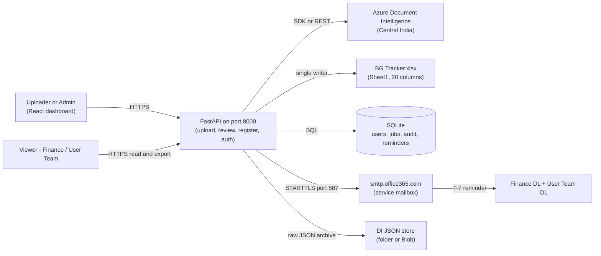
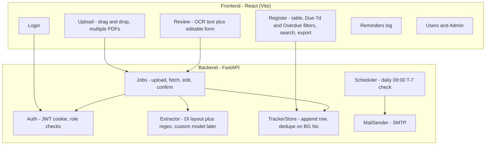
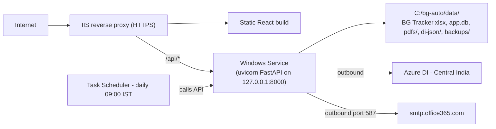

# 01 — System Architecture

## 1. Purpose

This document describes the building blocks of BG Automation and where they
run. Read it if you are setting up the project, deploying it, or adding a
new integration.

## 2. Context and scope

- In scope: frontend, backend API, database, Excel tracker, OCR service,
  mail service, VM deployment.
- Out of scope (Phase 1): Microsoft Graph, SharePoint live sync, Entra SSO.
  The code must keep clean seams so these can be added later without rewrites.

## 3. System context

A user uploads BG PDFs on a web dashboard. The backend extracts fields with
Azure Document Intelligence, a human reviews the result, and confirmed rows
are appended to the Excel tracker. A daily job emails Finance and the User
Team 7 days before expiry.

Phase 1 has no Graph, SharePoint, or Entra. Each external dependency sits
behind an interface: `Extractor`, `TrackerStore`, `MailSender`,
`AuthProvider`.

## 4. Components

| Component | Responsibility | Key rule |
|-----------|---------------|----------|
| Upload | Accept PDFs, create a job per file | Max file size and type validated before queuing |
| Extractor | Call DI, apply regex, return fields + confidence | Never invent a value; leave low-confidence fields blank |
| Review | Let humans fix fields and pick dropdowns | Uploader edits own drafts; admin edits any |
| TrackerStore | Append confirmed rows to Excel | One writer at a time; reject duplicate BG No with 409 |
| MailSender | Send T-7 mails, log results | Retry 3 times, then dead-letter |
| Auth | Login, roles, audit | Every mutation is logged |

## 5. Deployment on the Windows VM

- IIS ends TLS and forwards `/api/*` to the backend.
- The service account owns the data folder. End users never open the Excel file directly.
- All secrets and endpoints come from environment variables (`DI_ENDPOINT`,
  `DI_KEY`, `SMTP_*`, `JWT_SECRET`, paths), so a later move to App Service
  needs config changes only.
- Docker is optional for the pilot.

## 6. Acceptance criteria

- [ ] A new developer can draw the data path (browser → API → DI → Excel → mail) from this file alone.
- [ ] Every external system maps to one interface (`Extractor`, `TrackerStore`, `MailSender`, `AuthProvider`).
- [ ] Deployment steps work on a fresh Windows VM without code edits.

## References

- Master plan §4: `../BG_Automation_Plan.md`
- Data model: `02-data-model.md`
- Hosting detail: `06-email-scheduler-hosting.md`
