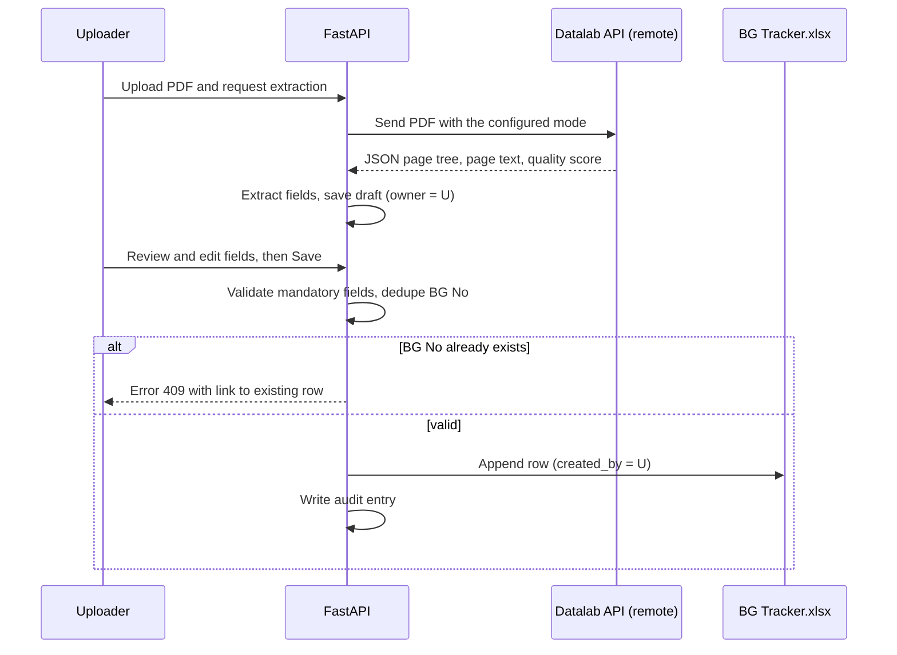
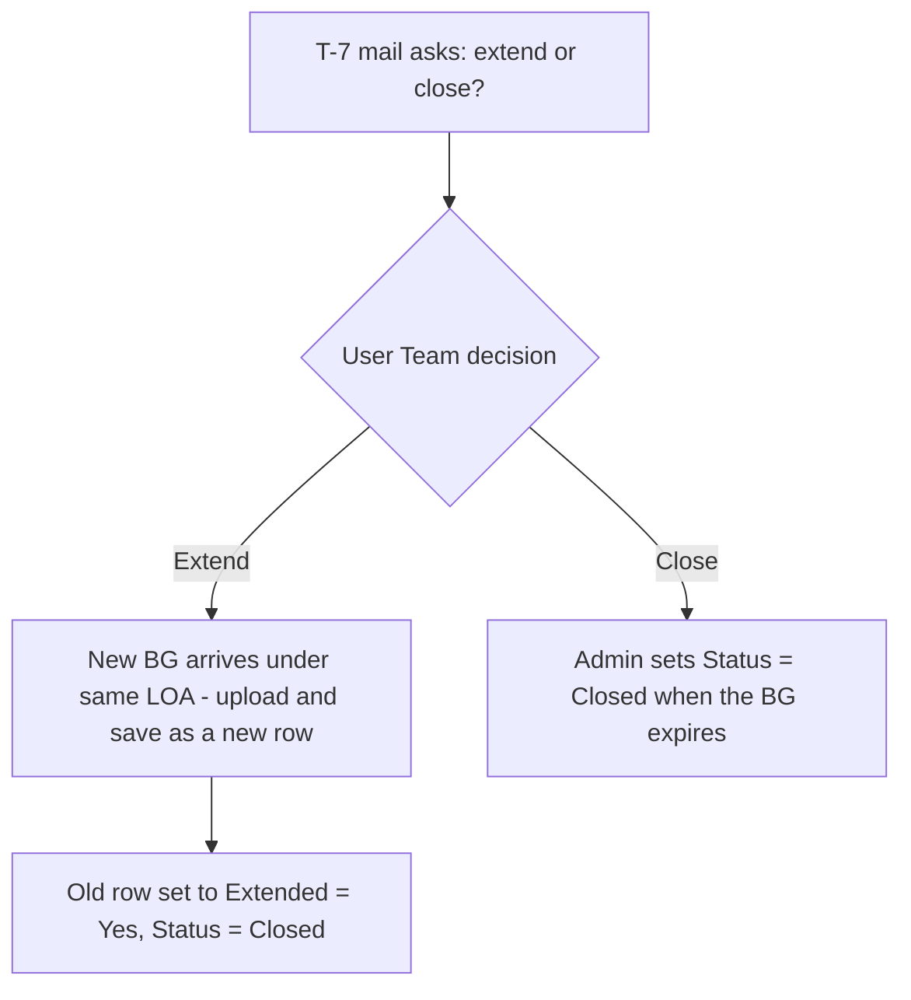
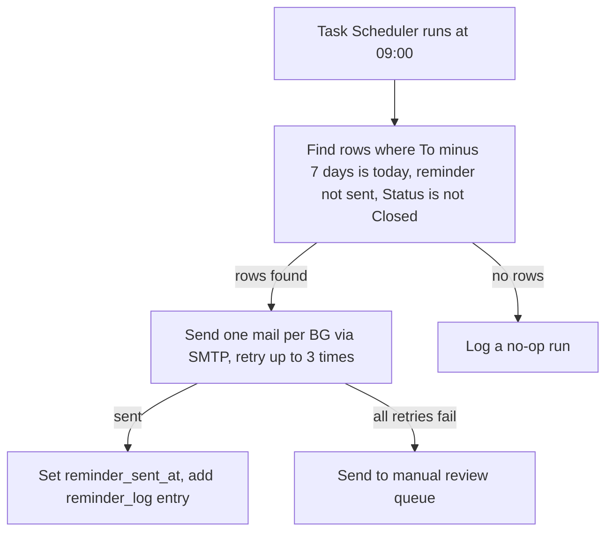
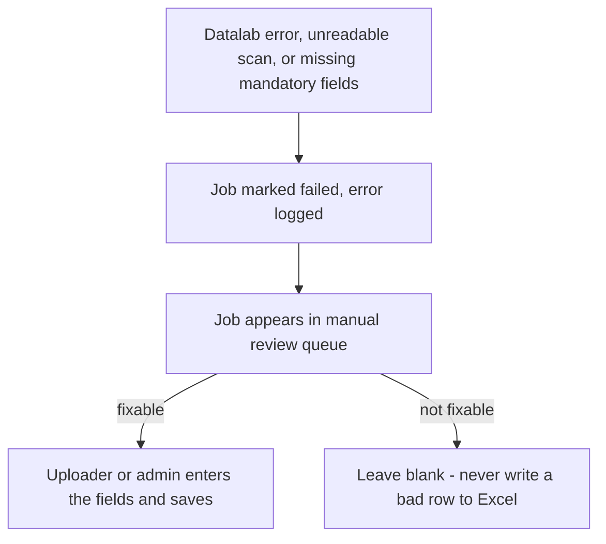

# 05 — Process Flows

## 1. Purpose

This document shows step by step what happens in each scenario. If you are
unsure how roles, OCR, Excel, and mail fit together, start here.

## 2. Flow A — Upload, review, and save

The uploader reviews their own extracted values and saves the run directly.

Accept: uploader saves own run directly; duplicate BG No never creates a second row.

## 3. Flow B — Extend or Close (same LOA)

Accept: the old row is never deleted; history is preserved.

## 4. Flow C — Daily T-7 reminder (09:00 IST)

Accept: no BG gets two T-7 mails; every send is logged with recipients and subject.

## 5. Flow D — Failure and manual queue (ST008)

Accept: failed jobs never reach Excel; blanks are explicit, not guessed.

## References

- Architecture: `01-architecture.md`
- Auth: `03-auth.md`
- Email detail: `06-email-scheduler-hosting.md`
