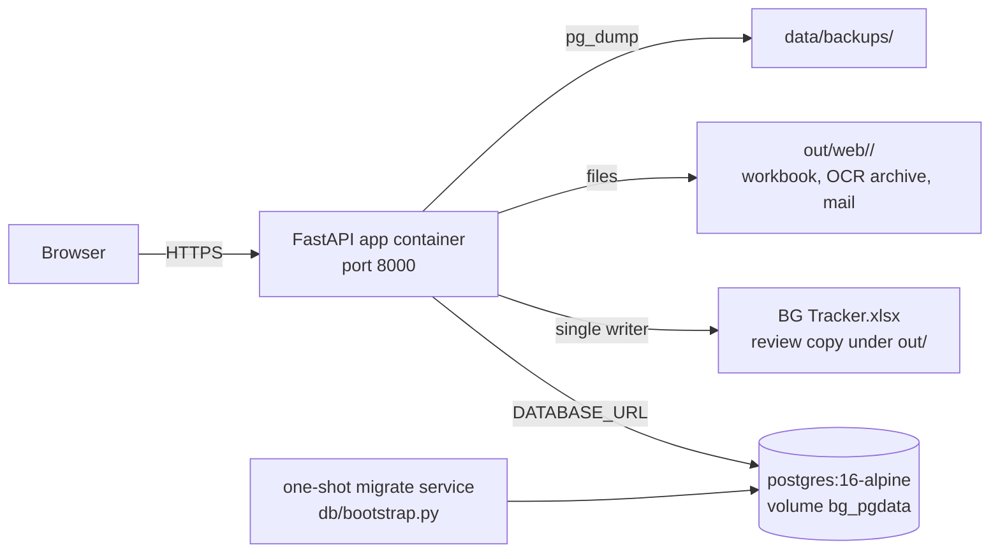

# 07 — SQLite to PostgreSQL Migration

## 1. Purpose

This document is the working plan for retiring SQLite and moving the live
application to PostgreSQL. Read it before changing `backend/bgauto/store.py`,
adding a migration, or touching a deployment file.

It records the decisions already agreed, the exact schema gap, the data that
must move, the code that must change, and the cutover and rollback steps.

## 2. Context and scope

**In scope**

- The application database: users, sessions, roles, the BG register, LOA
  records, reminders, audit log and the Firecrawl lookup cache.
- The master data that feeds the dropdowns and OCR matching, with
  `docs/master-data.md` as the source of truth.
- Schema, data migration, backend SQL, Docker deployment, backups and tests.

**Out of scope**

- The Excel tracker (`BG Tracker.xlsx`) and its review copy. The workbook stays
  the business record and the single-writer rule does not change.
- Review run state under `out/web/<run>/`. Uploads and manifests remain files.
- OCR (Datalab) and the optional Firecrawl lookup themselves.
- Head Office departments and offices listed at the end of
  `docs/master-data.md`. No table, column, dropdown or screen uses them, so
  they are not seeded. Adding them later is a separate change.

## 3. Current state

| Item | Today |
|---|---|
| Live database | SQLite at `db/sqlite/bg_automation.sqlite3`, committed to git |
| Access layer | Raw `sqlite3` in `backend/bgauto/store.py` and five modules |
| Schema management | `db/sqlite/schema.sql` baseline plus an additive top-up in `backend/bgauto/schema.py`; `PRAGMA user_version` is `0` |
| PostgreSQL | `db/migrations/V1__schema.sql`, `V2__seed.sql`, `db/apply.py` and `db/docker-compose.yml` exist, but no application code imports Postgres |
| Migrations runner | `db/apply.py` applies `V*.sql` and verifies; `db/sqlite/apply.py` does the SQLite equivalent |
| Tests | A temp SQLite file built from `db/sqlite/schema.sql` (`backend/tests/support.py`) |

### 3.1 What the app actually reads

| Tables | Modules |
|---|---|
| `users`, `user_roles`, `roles`, `sessions` | `auth.py`, `web/security.py`, `web/api.py` |
| `audit_logs` | `store.audit()` on every mutating path; Audit screen |
| `bg_records`, `loa_records`, masters | `register.py` |
| `reminders` | `scheduler.py`, `register.mark_reminder_sent` |
| `lookup_cache` | `lookup.py` |
| `company`, `project`, `toll_plaza`, `bank`, `contractor`, `nature_of_service`, `bg_status`, `bg_type` | `masters.py`, `masterdata.py`, `register.py` |
| `ocr_results`, `v_bg_register` | Nothing in the app; verifier scripts only |

### 3.2 Drift that matters

The committed SQLite file is older than `db/sqlite/seed.sql` and the new
`docs/master-data.md`:

| Data | Live SQLite | Source of truth |
|---|---|---|
| Companies | 1 (`NSPPL`, legacy alias) | 3 SPVs |
| Projects | 12, Southern only, plus a bogus `RS,SB` row | 28 |
| Toll plazas | 32 | 46 |
| Natures of service | 25 | 27 |
| Bank / contractor | 7 / 32 legacy rows | Empty; created by confirmed BGs |

The live file is what the app uses today, so the limited dropdowns are a real
behavioural limitation, not only a documentation problem. The migration
replaces those masters with the canonical set.

The Postgres baseline is also behind. `V1__schema.sql` lacks `sessions`,
`lookup_cache`, `users.failed_attempts`, `users.locked_until` and the master
metadata columns; its `audit_logs` CHECK rejects actions the app already writes;
and `reminders.recipients` / `audit_logs.ip` / JSONB parameters do not match how
the code uses them. Phase 1 closes this gap.

`plan/02-data-model.md` still describes `jobs`, `audit_log` and `reminder_log`.
Those tables do not exist. Phase 8 rewrites it.

## 4. Decisions

| # | Decision | Choice |
|---|---|---|
| D1 | Where Postgres runs | Self-hosted `postgres:16-alpine` in Docker, volume `bg_pgdata` |
| D2 | What the new database contains | Fresh database, canonical masters, and only the referenced live business rows |
| D3 | Cutover style | Big-bang maintenance window; keep the SQLite file for rollback |
| D4 | Test strategy | Integration tests against a disposable Postgres schema |
| D5 | Master data source | `docs/master-data.md`, imported by the existing master importer |
| D6 | Schema changes | Versioned SQL files, `V3` onward; no runtime schema top-up |

## 5. Target architecture



- One root `docker-compose.yml` runs `db`, `migrate` and `app`.
- `db/sqlite/` is deleted after the rollback window.
- The Excel tracker, review workbook, run manifests and PDF archive do not move.

## 6. Phase 1 — Schema parity (`V3__schema.sql`)

Do not edit V1 or V2; they are the historical baseline. V3 must make the
database match what the code reads.

### 6.1 Missing tables

```sql
CREATE TABLE IF NOT EXISTS sessions (
  token_hash TEXT PRIMARY KEY,
  user_id    UUID NOT NULL REFERENCES users(id) ON DELETE CASCADE,
  created_at TIMESTAMPTZ NOT NULL DEFAULT now(),
  expires_at TIMESTAMPTZ NOT NULL,
  last_seen  TIMESTAMPTZ,
  ip         TEXT,
  user_agent TEXT
);
CREATE INDEX IF NOT EXISTS idx_sessions_user ON sessions(user_id);
CREATE INDEX IF NOT EXISTS idx_sessions_expires ON sessions(expires_at);

CREATE TABLE IF NOT EXISTS lookup_cache (
  field      TEXT NOT NULL,
  query      TEXT NOT NULL,
  payload    JSONB NOT NULL,
  created_at TIMESTAMPTZ NOT NULL DEFAULT now(),
  PRIMARY KEY (field, query)
);
```

### 6.2 Missing columns

```sql
ALTER TABLE users ADD COLUMN IF NOT EXISTS failed_attempts INTEGER NOT NULL DEFAULT 0;
ALTER TABLE users ADD COLUMN IF NOT EXISTS locked_until TIMESTAMPTZ;

ALTER TABLE company
  ADD COLUMN IF NOT EXISTS source TEXT,
  ADD COLUMN IF NOT EXISTS is_active BOOLEAN NOT NULL DEFAULT true;

ALTER TABLE project
  ADD COLUMN IF NOT EXISTS state TEXT,
  ADD COLUMN IF NOT EXISTS "round" INTEGER,
  ADD COLUMN IF NOT EXISTS project_manager TEXT,
  ADD COLUMN IF NOT EXISTS source TEXT,
  ADD COLUMN IF NOT EXISTS is_active BOOLEAN NOT NULL DEFAULT true;

ALTER TABLE toll_plaza
  ADD COLUMN IF NOT EXISTS chainage TEXT,
  ADD COLUMN IF NOT EXISTS toll_manager TEXT,
  ADD COLUMN IF NOT EXISTS maintenance_manager TEXT,
  ADD COLUMN IF NOT EXISTS corridor_manager TEXT,
  ADD COLUMN IF NOT EXISTS source TEXT,
  ADD COLUMN IF NOT EXISTS is_active BOOLEAN NOT NULL DEFAULT true;

ALTER TABLE bank       ADD COLUMN IF NOT EXISTS source TEXT;
ALTER TABLE contractor ADD COLUMN IF NOT EXISTS source TEXT;
```

### 6.3 Behavioural fixes

| Problem | V3 action |
|---|---|
| `audit_logs.action` CHECK rejects `login_failed`, `locked`, `logout`, `submit`, `review_save`, `password_change`, `role_change`, `reminder_sent`, `reminder_resend`, `workbook_reset` | Drop `audit_logs_action_check` and recreate it with the full list from `backend/bgauto/schema.py` |
| `audit_logs.ip INET` rejects `testclient` and hostnames | `ALTER COLUMN ip TYPE TEXT USING ip::text` |
| `bg_status` / `bg_type` have no ordering column; SQLite uses `rowid` | Add `sort_order INTEGER NOT NULL DEFAULT 0`; set the approved order (`Draft, Active, Expiring, Expired, Extended, Closed`; `PBG, ABG`) |
| `reminders.recipients` is `TEXT[]` but the code writes a JSON string | Keep `TEXT[]`; change `scheduler.py` to pass and read a list |
| `audit_logs.old_data` / `new_data` are JSONB but the code writes a JSON string | Keep JSONB; use `psycopg.types.json.Jsonb` in `store.audit` and stop calling `json.loads` on decoded values in `web/api.py` |
| `db/apply.py` verifies the old seed (`company 1`, `project 12`, `contractor 31`, `bank 7`, `nature 25`) | Update to `company 3`, `project 28`, `toll_plaza 46`, `nature_of_service 27`; drop bank/contractor minimums |

`ocr_results` and `v_bg_register` stay in V1. They are unused by the app; no
rows are migrated and no code depends on them.

### 6.4 Migration runner

- Keep `db/apply.py` as the SQL runner.
- Add `db/bootstrap.py`: apply `V1`–`V3`, then seed masters from
  `docs/master-data.md`, then run the verifier.
- Remove `backend/bgauto/schema.py`'s SQLite top-up from the runtime path. The
  web app checks the required schema version at startup and fails with a
  readable message if the database is behind.

**Exit criteria:** `python db/apply.py --verify-only` passes on a clean database,
and a schema-parity test confirms every table and column the backend references
exists.

## 7. Phase 2 — Seed masters from `docs/master-data.md`

### 7.1 Source of truth

On 2026-11-12 the file was parsed with the existing
`bgauto.masterdata.parse_master_markdown` and verified:

| Item | Count |
|---|---|
| Companies | 3 |
| Projects | 28 (Eastern 7, Southern 11, Western 10) |
| Toll plazas | 46 (Eastern 14, Southern 15, Western 17) |

It matches `db/sqlite/seed.sql` field-for-field for company, project code,
project name, state, round, project manager, plaza name, chainage, toll
manager, maintenance manager and corridor manager. No differences were found.

### 7.2 What is seeded

| Master | Fields | Notes |
|---|---|---|
| `company` | name | The three SPVs; `NSPPL` / `NEPPL` / `NWPPL` are aliases only |
| `project` | code, name, company_id, state, `"round"`, project_manager | One row per corridor |
| `toll_plaza` | project_id, name, chainage, toll_manager, maintenance_manager, corridor_manager | Exactly one project per plaza |

Rules:

- Rows created by the import are tagged `source = 'imported'` and `is_active = 1`.
- Rows that disappear from the document are set `is_active = 0`, never deleted,
  so old BGs still resolve.
- Rows created by a reviewer (`source = 'manual'`) are never overwritten or
  deactivated by the import.
- Re-running the import is idempotent and reports no changes.
- Blank managers and blank chainage in the document stay `NULL`. The source
  typo `Toll Mananger` is already handled by the parser (`Man[ae]nger`).

### 7.3 What is not seeded

- Bank and contractor registries: they start empty and gain a row from each
  confirmed BG (or the optional Firecrawl name choice). This is unchanged.
- Head Office departments and offices: no schema or UI uses them.
- Corridor names, combined-plaza spellings and OCR aliases: the matcher handles
  spelling drift by similarity; they are not rows.

### 7.4 How it runs

1. V2 keeps its base inserts for companies, project codes and plazas, so a
   fresh database has stable IDs.
2. `db/bootstrap.py` then runs the ported importer against
   `docs/master-data.md`, which fills `state`, `round`, `project_manager`,
   `chainage` and the three managers, and reconciles active flags.
3. `python -m bgauto.cli import-masters docs/master-data.md` remains the manual
   command for future document updates.
4. Replace the external-document assumptions in `backend/tests/test_master_seed.py`
   with a test that parses `docs/master-data.md` and asserts the database
   matches it.

**Exit criteria:** a fresh database has 3 companies, 28 active projects and 46
active plazas with all metadata populated, and the parity test passes.

## 8. Phase 3 — Data migration

One-shot `db/import_sqlite.py`, read-only against the SQLite file, `--dry-run`
by default. Fresh database plus canonical masters; only referenced business
rows move.

| Source | Rows | Action |
|---|---|---|
| `users` | 3 | Copy IDs (32-hex is valid UUID input), scrypt hashes, timestamps; integer `is_active` to boolean |
| `user_roles` | 3 | Map by role name |
| `sessions` | 1 | Skip; force a fresh sign-in |
| `loa_records` | 1 | Copy ID, number, creator, timestamps |
| `bg_records` | 1 | Map foreign keys; see 8.1 |
| `audit_logs` | 45 | Decode JSON text to JSONB, IP text, map `user_id`; preserve `ts` |
| `reminders` | 0 | Skip |
| `lookup_cache` | 0 | Skip |
| `ocr_results` | 0 | Skip |
| 31 legacy contractors, 7 banks, 12 old projects, 1 old company | — | Do not copy; canonical seed wins |

### 8.1 The one live BG

`bg_no = 0024NDLG00226526`

| Field | Live value | Mapping |
|---|---|---|
| company | `NSPPL` | `NHIT Southern Projects Private Limited` (alias) |
| project | `SB` | `SB` exists in the canonical set |
| toll plaza | `Bhojpuri & Mudipar` | `Bhojpuri` (combined spellings are deliberately not seeded; the register stores one plaza per BG) |
| nature | `Manpower` | Exists |
| contractor | `ARYA OMNITALK WIRELESS SOLUTIONS PVT LTD` | Create with `source = 'migrated'` |
| bank | `ICICI Bank Limited` | Create with `source = 'migrated'` |
| LOA | `NSPPL/TMS/2025/01` | Copy |
| amount / dates / status | 8,126,469 / 2025-09-04 / 2029-09-03 / Active | Copy unchanged |
| created_by | `admin` | Map by user ID |

The audit rows currently contain actions `confirm`, `extract`, `login`,
`logout`, `upload` and `workbook_reset`. `logout` and `workbook_reset` are the
first proof that the V3 CHECK widening is mandatory.

### 8.2 Verification

- Row counts match for `users`, `user_roles`, `loa_records`, `bg_records` and
  `audit_logs`.
- Foreign-key violations are zero.
- The admin can still sign in with the existing password; the other two
  accounts still have their roles.
- The Register, export, reminder dry run and Audit screen show the same data.
- The script is idempotent and prints a per-table diff.

**Exit criteria:** the verifier passes and the smoke test in Phase 7 succeeds.

## 9. Phase 4 — Application port

| File | Change |
|---|---|
| `store.py` | Replace `sqlite3` with `psycopg` and `psycopg_pool`; use `dict_row`; one transaction per `connect()`; keep `audit()`, `iso()`, `utcnow()` |
| `config.py` | `DATABASE_URL` replaces `DB_PATH`; clear startup error if `BG_DB` is still set; add pool sizing |
| `register.py` | ~75 placeholders; `lastrowid` / `rowid` to `INSERT ... RETURNING id`; `datetime('now')` to `now()`; `date('now','localtime')` to `(now() AT TIME ZONE 'Asia/Kolkata')::date`; `LIKE` to `ILIKE`; remove `date(r.to_date)`; return `duplicate` on a unique violation |
| `masterdata.py` | ~48 placeholders; `RETURNING id`; booleans; no direct `sqlite3.connect` |
| `auth.py` | ~40 placeholders; `COLLATE NOCASE` to citext or `lower()`; `INSERT OR IGNORE` to `ON CONFLICT DO NOTHING`; booleans; catch `psycopg.errors.UniqueViolation` |
| `scheduler.py` | ~21 placeholders; `RETURNING id`; recipients as a list; `now()` |
| `lookup.py` | ~6 placeholders; drop the `executescript` DDL; cast payload to JSONB |
| `masters.py` | Drop the read-only file URI; order by `sort_order`; boolean filters |
| `web/runs.py` | Masters cache keyed on file `mtime` becomes a short TTL or revision counter |
| `web/api.py` | `psycopg.Error`; health reports connectivity/version instead of a path; audit uses decoded JSONB |
| `backup.py` | `pg_dump --format=custom` plus the existing workbook/PDF zip; new restore hint |
| `schema.py` | Remove the SQLite top-up; keep only a schema-version check or delete the module |
| `web/security.py` | No SQL change; inherits the new store |

### 9.1 Dialect rules

| SQLite | PostgreSQL |
|---|---|
| `?` | `%s` |
| `datetime('now')` | `now()` |
| `date('now', 'localtime')` | `(now() AT TIME ZONE 'Asia/Kolkata')::date` |
| `date('now', 'localtime', '+7 days')` | `(now() AT TIME ZONE 'Asia/Kolkata')::date + 7` |
| `date('now', '-N days')` | `now() - (%s * INTERVAL '1 day')` |
| `INSERT OR IGNORE` | `INSERT ... ON CONFLICT DO NOTHING` |
| `cursor.lastrowid` | `INSERT ... RETURNING id` |
| `ORDER BY rowid` | `ORDER BY sort_order` |
| `COLLATE NOCASE` | citext column or `lower()` |
| `LIKE` | `ILIKE` to preserve case-insensitive search |
| `COALESCE(is_active, 1) = 1` | `is_active IS NOT FALSE` |
| `1` / `0` for booleans | `True` / `False` |
| `sqlite3.Error` | `psycopg.Error` |
| `sqlite3.IntegrityError` | `psycopg.errors.UniqueViolation` |
| `executescript` | Removed; DDL comes from migrations |

`sqlite3.Row` supports both `row["name"]` and `row[0]`; `psycopg` does not.
Normalise the ~38 mixed access sites to named access.

Set the session timezone to UTC (matching `datetime('now')`) and compute
"today" explicitly in IST. Without this, T-7 reminders and the Overdue filter
shift by a day.

## 10. Phase 5 — Deployment

- `backend/requirements.txt`: add `psycopg[binary]` and `psycopg_pool`.
- `Dockerfile`: install `postgresql-client` for `pg_dump`; keep the non-root
  runtime user.
- Root `docker-compose.yml`:
  - add `db` (`postgres:16-alpine`, volume `bg_pgdata`, healthcheck);
  - add a one-shot `migrate` service running `python db/bootstrap.py`;
  - make `app` depend on `db` healthy and `migrate` completed;
  - add `DATABASE_URL`;
  - remove `./db/sqlite:/app/db/sqlite`.
- Retire or mark `db/docker-compose.yml` as a database-only development file.
- `.env.example`: replace `BG_DB` guidance with `DATABASE_URL` and
  `POSTGRES_*`; document the migrate step.
- Health: report database connectivity and server version; never the password.

## 11. Phase 6 — Tests

- `backend/tests/support.py`: create a unique schema per test
  (`CREATE SCHEMA test_<hex>; SET search_path`), apply V1–V3, seed masters,
  drop cascade on teardown.
- Replace the 9 direct `sqlite3.connect` sites and the `schema.sql` fixture.
- Convert positional row access to named access.
- Gate on `TEST_DATABASE_URL`; skip with a clear message when absent. CI starts
  the compose `db` service.
- Add a schema-parity test and a master-data parity test (doc vs database).
- Run the full suite (~172 tests) against Postgres before cutover.

## 12. Phase 7 — Cutover and rollback

### 12.1 Cutover

1. Announce the maintenance window; stop the app.
2. Copy `db/sqlite/bg_automation.sqlite3` to `data/backups/`; keep the previous
   image tagged.
3. `docker compose up -d db`; wait for healthy.
4. `docker compose run --rm migrate` (V1–V3 + master seed).
5. `docker compose run --rm app python db/import_sqlite.py --dry-run`, then run
   it for real.
6. Start the app with `DATABASE_URL`.
7. Smoke test:
   - sign in as `admin` with the existing password;
   - Register shows `0024NDLG00226526` and the canonical dropdowns;
   - export the register;
   - run a reminder dry run;
   - Audit shows 45 rows;
   - upload one sample PDF through to review.
8. `python db/apply.py --verify-only` and the full test suite.

### 12.2 Rollback

Stop the app and start the previous image with the SQLite mount. The SQLite file
was only read, never modified. No reverse data migration is needed.

## 13. Phase 8 — Cleanup

After the rollback window:

- delete `db/sqlite/` and `db/sqlite/apply.py`;
- delete `backend/bgauto/schema.py` if nothing else uses it;
- remove SQLite references from `backend/README.md`, `db/README.md`,
  `Dockerfile`, `.dockerignore` and `.env.example`;
- rewrite `plan/02-data-model.md` to the real normalised model;
- update `plan/01-architecture.md` (Postgres instead of SQLite);
- add a `plan/00-log.md` entry;
- keep `docs/master-data.md` as the master source and
  `python -m bgauto.cli import-masters` as the update path.

## 14. Acceptance criteria

- [ ] `V3__schema.sql` closes every gap listed in Phase 1.
- [ ] `python db/apply.py --verify-only` passes on a clean database.
- [ ] A fresh database has 3 companies, 28 active projects and 46 active plazas
      with state, round, project manager, chainage and all three managers.
- [ ] The master-data parity test passes and the importer is idempotent.
- [ ] The three users, their roles, the LOA, the one BG and the 45 audit rows
      are present and correct after migration.
- [ ] The admin can sign in with the existing password.
- [ ] Register, search, filters, export, reminders, audit and health work.
- [ ] No `sqlite3` import remains in `backend/bgauto`.
- [ ] The full test suite passes against Postgres.
- [ ] A `pg_dump` backup and restore have been tested.
- [ ] Rollback to SQLite is documented and the old file is untouched.

## 15. Risks

| Risk | Mitigation |
|---|---|
| Day-boundary shift in T-7 and Overdue | Pin the session timezone to UTC; compute "today" in IST explicitly |
| Search results change because `LIKE` is case-sensitive in Postgres | Use `ILIKE` and add a test for mixed-case search |
| Combined plaza name on the live BG | Map `Bhojpuri & Mudipar` to canonical `Bhojpuri`; document the choice |
| Audit writes fail on the narrow CHECK | Widen the CHECK in V3 before any sign-in |
| JSONB and text-array parameters fail at runtime | Use `Jsonb` and native lists; covered by tests |
| Two writers race on `bg_no` | Catch `UniqueViolation` and return `duplicate` |
| Masters go stale again | `docs/master-data.md` is the only source; parity test enforces it |
| `pg_dump` missing from the image | Install `postgresql-client` and test the backup step |
| Connection growth from per-request connects | Use a small `psycopg_pool` connection pool |

## References

- Master data: `../docs/master-data.md`
- Current schema: `../db/sqlite/schema.sql`
- Postgres baseline: `../db/migrations/V1__schema.sql`, `../db/migrations/V2__seed.sql`
- Data model (to be rewritten): `02-data-model.md`
- Architecture: `01-architecture.md`
- Change log: `00-log.md`
